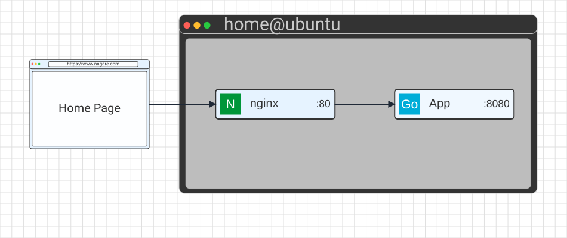

# Nagare

Nagare is a Go-based diagram rendering engine that converts a simple domain-specific language (DSL) into SVG diagrams.

## Installation

```bash
go install github.com/saasuke-labs/nagare/cmd/main@latest
```

## Usage

Nagare can be used in three ways:

### 1. HTTP Server Mode

Start the server on port 8080 (or specify a custom port):

```bash
# Default port 8080
nagare

# Custom port
nagare -port 3000
```

Send POST requests to render diagrams:

```bash
curl -X POST http://localhost:8080/render \
  -H "Content-Type: text/plain" \
  -d '@diagram.nagare'
```

### 2. CLI Mode

Render a diagram file directly to SVG:

```bash
# Render to SVG (format auto-detected from extension)
nagare -input diagram.nagare -output diagram.svg


# Explicitly specify format
nagare -input diagram.nagare -output output.file -format svg
```

### 3. Library Mode

Import nagare as a Go library in your own projects:

```go
package main

import (
    "fmt"
    "log"

    "github.com/saasuke-labs/nagare/pkg/nagare"
)

func main() {
    diagramCode := `
@layout(w:500,h:300)

client:Browser(url: "https://example.com", text: "Web App", x:50,y:100,w:180,h:120)
server:Server(title: "API Server", icon: "server", port: 8080, x:300,y:100,w:150,h:50)

client.e --> server.w
`

    svg, err := nagare.RenderToSVG(diagramCode)
    if err != nil {
        log.Fatalf("Error: %v", err)
    }

    fmt.Println(svg)
}
```

Install the library in your project:

```bash
go get github.com/saasuke-labs/nagare
```

## Syntax Notes

Nagare supports inline attributes directly on node declarations:

```text
browser:Browser(title: home, x: 50, y: 100)
db:DB(x: 10)
DB(x: 10)  # anonymous component id is auto-generated
```

`@layout(...)` and action states (for example `@db.read(...)`) are still supported.
`@id(...)` and `name:Type@state` syntax remain fully supported. Inline attributes are also supported and are often convenient for colocating component configuration with the declaration.

## Chart DSL Notes

Nagare charts support mixed series styles in the same chart definition:

- `style: line`, `dashed`, `dotted`
- `style: bar` for column/bar rendering
- `style: marker` for point annotations (marker dot + value text above each point)
- `style: watercolor` on its own line paints the whole chart (see [Watercolor style](#watercolor-style))

Bar series can also be stacked by declaring `stack` values aligned with each series:

```text
series: jog | walk | total distance | jog blocks
style: bar | bar | line | marker
stack: session | session | none | none
yaxis: time | time | distance | blocks
type: duration | duration | number | number
```

When multiple `bar` series share the same stack group (for example `session`), they stack at each x-position and share the same y-axis scale. This works with `xaxis: date` and with duration-typed y-values (`type: duration`) so bar heights are computed from parsed duration seconds while axis labels still render as duration strings.

Stacked bar segments preserve each series color (no forced color blending), and bar widths are automatically adapted to x-density so dense charts remain readable without excessive overlap.

### Chart axes

Axis ticks are chosen so that every label is a round value sitting where that value is:

- **Y axes.** An automatic scale starts at zero (or at a round value below the lowest negative point) and ends on a round value, split into five equal intervals: `0, 5, 10, 15, 20, 25` rather than `-2.0, 2.8, 7.6, …`. Duration scales use time steps such as `15:00` or `1:00:00`. Both Y axes and the horizontal grid lines share the same five intervals. To choose the range yourself, set `min` and `max` on the scale.
- **X axis.** When there is room, every data point gets its own label, directly under the point. Longer series fall back to round steps (`0, 10, 20, …`) or calendar boundaries: days, weeks, then the first day of a month, quarter or year. Series with one point per month are labelled `Jan, Feb, …`, and on an axis that spans several years January shows the year instead.
- Dates are read and labelled in UTC, so a chart renders the same on every machine.

The `<svg>` element carries `width`, `height` and a matching `viewBox`, so a chart keeps its natural size by default and can be scaled with CSS (`max-width: 100%; height: auto`).

## Layout Overrides

You can control the overall canvas dimensions with a global `@layout` directive. This is useful when you need extra room for connections or when you want diagrams to render inside a specific viewport.

```text
@layout(w: 800, h: 600)

browser:Browser(title: "home")
vps:VM(title: "ubuntu") {
    nginx:App
    app:App
}
```

The `layout` stage resolves these geometry overrides before components are instantiated, so every downstream step (child placement, connection routing, SVG rendering) respects the requested dimensions.

### Themes and colours

Every component is drawn from one shared visual system: the same card shape, stroke, corner radius and type scale, with a line icon and an accent colour per component type. The canvas is transparent, so a diagram sits on whatever background the page has.

Pick the theme in the layout directive (`light` is the default):

```text
@layout(w: 800, h: 600, theme: dark)
```

Colour props are optional overrides on top of the theme:

| Prop | Applies to |
| --- | --- |
| `bg` | Card, window chrome or cylinder fill |
| `fg` | Text colour |
| `accent` | Icon and highlight colour (where the component has one) |
| `contentBg` | Content area of `Browser` and `VM` |

If an `fg` override would be unreadable on its background, a contrasting text colour is used instead.

### Watercolor style

Add `style: watercolor` to the layout directive and the same diagram is painted instead of filled:

```text
@layout(w: 1000, h: 450, style: watercolor)
```

Each component becomes a transparent wash of pigment on a sheet of cold-press paper, with one pen line drawn over it slightly off-register:

- **Washes.** Every accent colour maps to the watercolour pigment closest to it (blue → cobalt, teal → viridian, amber → gamboge, pink → quinacridone rose, …). A wash is built from a few deformed layers, so its edge is soft and uneven, it dries darker at the rim, granulates, and pigment settles toward the bottom. Overlapping washes glaze (multiply) the way real paint does.
- **Ink.** Outlines and arrows are single pen strokes with pressure, a little tremor and tapered ends. The pen lifts once on long outlines, and each outline is a darker mix of its own wash, so line and colour read as one.
- **Colours you set still apply.** `bg`, `fg` and `accent` become the pigments. Light colours are laid as body colour (opaque, like gouache) so a pale card still shows on a dark container.
- **Both themes.** `theme: dark` paints on a dark-grey sheet with chalk-white ink, and washes lighten the sheet instead of darkening it.
- **Deterministic.** Brush marks are seeded from each component's id, so a diagram renders identically every time and two identical components still look hand-made.
- **Paper.** The sheet is part of the drawing. Add `paper: none` to keep the canvas transparent and paint straight onto the page.

```text
@layout(w: 1000, h: 240, theme: dark, style: watercolor, paper: none)
```

The texture comes from a handful of shared SVG filters (paper tooth, wash, ink), so the output is still a single static SVG with no script. Without filter support the drawing still reads as layered washes and ink. Labels switch to a book serif (`Iowan Old Style`, `Palatino`, `Georgia`, …) through a style rule scoped to painted diagrams.

Charts take the same option on a line of their own:

```text
chart
title: Deploys per week
style: watercolor
```

Axes are drawn in ink, the grid in pencil, lines in each series' pigment with a soft graded wash beneath, and bars are laid as washes. `paper: none` works here too.

### Browser and VM Example

```text
@layout(w:950,h:400)

browser:Browser(url: "https://www.nagare.com", text: "Home Page", x:50,y:100,w:200,h:150)
vps:VM(title: "home@ubuntu", bg: "#333", fg: "#ccc", x:300,y:&browser.c,w:600,h:300) {
    nginx:Server(title: "nginx", icon: "nginx", port: 80, bg: "#e6f3ff", fg: "#333", x:50,y:&browser.c,w:200,h:50)
    app:Server(title: "App", icon: "golang", port: 8080, bg: "#f0f8ff", fg: "#333", x:350,y:&browser.c,w:200,h:50)
}

browser.e --> nginx.w
nginx.e --> app.w
```


### Composable Infrastructure Primitives

The infrastructure palette now supports primitive components that can be used directly in diagrams:

- `Cylinder` (base cylinder shell with title/subtitle)
- `Led` (mode-driven indicator with `mode:"green"` or `mode:"red"`)

`Led` currently supports one action: `blink` via state names like `@myLed.blink(begin:"0s",dur:"1s")`.

`Database` is now rendered as a composition of those primitives:

- 1 `Cylinder` for body + labels
- 1 red `Led` child (maps `write -> blink`)
- 1 green `Led` child (maps `read -> blink`)

So existing database actions still work (`@db.read(...)`, `@db.write(...)`), while the same visual primitives are available for custom higher-level components.

The composed database LEDs are positioned relative to the database width/height and scale proportionally with the database size, so resizing the database keeps indicator placement and sizing visually consistent.

### Component Rendering Ownership

The `pkg/diagram/components/*` packages now own per-component render-node translation.
Each component exposes `DrawFromRenderNode(id, props)` and resolves its own fallback geometry (`x`, `y`, `w`, `h`) from render props, which keeps `pkg/diagram/diagram.go` focused on tree traversal instead of per-type box defaults.
Render-tree recursion already applies parent/child `<g transform="translate(...)">` wrappers, so component templates should render using local coordinates (`x:0`, `y:0`) to avoid double-applying placement offsets.
When component actions semantically create arrows (for example request/response), keep action-to-style mapping at the owning component boundary and pass resolved geometry/style props to Arrow, keeping Arrow action-agnostic.

Parser behavior note: the parser currently records actions as state definitions (for example `@browser.request(...)`) but does not synthesize `Connection` entries from action names; explicit arrows (`from.anchor --> to.anchor`) remain the parser-level connection syntax.


## RFCs

- [RFC: Action-Driven Arrow Creation and Centralized Arrow Resolution](docs/RFC_PORT_AWARE_ARROWS.md)

## Project Structure

```
cmd/
    main.go          # HTTP server and main entry point
pkg/
    components/      # Shared SVG template/runtime primitives
    diagram/         # Diagram orchestration + component render-node translation
    layout/         # Layout engine and geometry calculations
    parser/         # DSL parser and AST builder
    props/          # Property parsing helpers
    renderer/       # SVG rendering engine
    tokenizer/      # DSL tokenizer
    version/        # Version information
static/
    playground.html  # Interactive diagram editor UI
```

## License

MIT


## Development

The Go module under `nagare/` powers the HTTP server and static rendering pipeline. Format and test Go code before sending a pull request.

### Quick Start with Just

This project uses [Just](https://github.com/casey/just) as a command runner. Install it first:

```bash
# macOS
brew install just

# Or download from https://github.com/casey/just
```

Available commands:

```bash
# Start the server
just start

# Start with hot reload (auto-restarts on code changes)
just start-watch

# Build the binary
just build

# Generate SVG from a .nagare file
just gen input.nagare output.svg

# Run tests
just test

# Run tests with coverage
just test-coverage

# Format code
just fmt

# Install development tools (air, goreleaser)
just install-tools

# Clean build artifacts
just clean
```

### CI Visual Previews

Nagare core is SVG-only. CI preview workflows publish SVG artifacts directly from Nagare output and do not perform WebP conversion in this repository.

### GCP Cloud Run Deployment CI

For a full step-by-step setup (CLI and GCP Console UI) for GitHub Actions Workload Identity Federation and Cloud Run deploys, see `docs/GCP_CLOUD_RUN_CI_SETUP.md`.

### Playground UI

Start the server and visit http://localhost:8080 to access the interactive playground. Features:

- Live diagram editor with syntax highlighting
- Instant preview rendering
- Keyboard shortcut: Cmd/Ctrl + Enter to render
- Save diagrams with custom names in browser local storage (with overwrite confirmation)
- Autosave restores your latest diagram when you return to the playground
- Example diagrams to get started

### Watch Mode

The watch mode uses [Air](https://github.com/air-verse/air) for hot reloading. It automatically restarts the server when:

- Go source files change (excluding tests)
- Component template files (.html) change

Install Air first:

```bash
just install-tools
# or manually: go install github.com/air-verse/air@latest
```

Then start with watch mode:

```bash
just start-watch
```

### Manual Development

If you prefer not to use Just:

```bash
# Clone the repository
git clone https://github.com/saasuke-labs/nagare.git

# Build
go build -o nagare ./cmd/main.go

# Test
go test ./...

# Run locally
go run ./cmd/main.go
```

The layout unit tests describe how connection routing, geometry inheritance, and canvas bounds interact.
They are a good starting point for understanding how new components should integrate with the existing pipeline.
